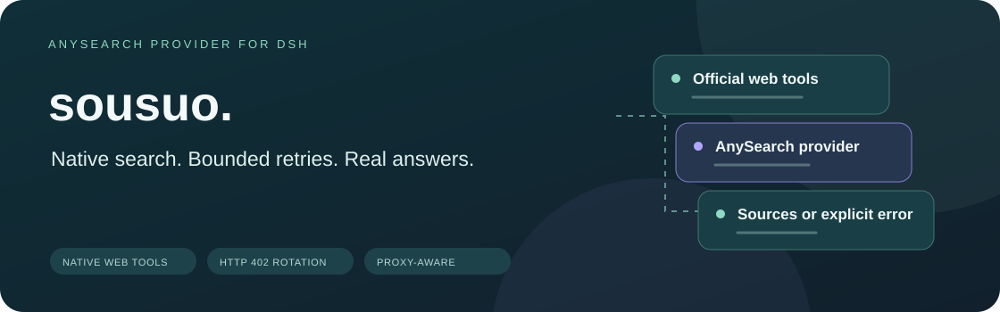
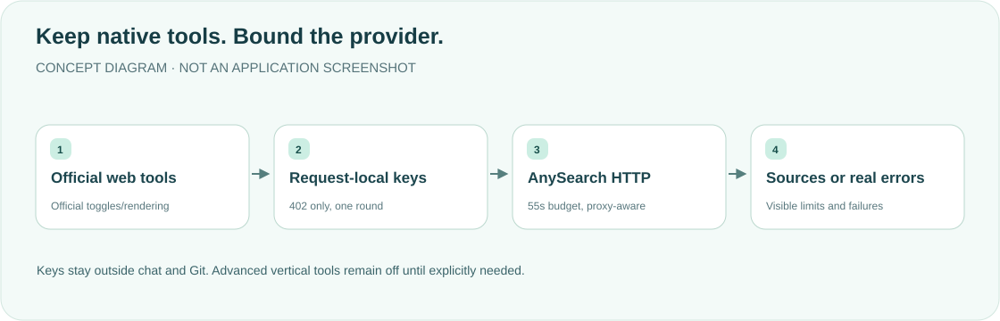

<div align="center">

<h1>sousuo · Search, then answer</h1>
<p><strong>Native web_search/web_fetch, AnySearch and bounded HTTP402 key rotation.</strong></p>
<p><a href="README.md">简体中文</a> · <strong>English</strong></p>
<p><a href="package.json">v0.1.7</a> · <a href="LICENSE">MIT</a> · DSH desktop provider</p>
<p><a href="#features">Features</a> · <a href="#how-it-works">How it works</a> · <a href="#installation">Installation</a> · <a href="#key-file">Key file</a> · <a href="#boundaries">Boundaries</a> · <a href="#development">Development</a></p>
</div>

---

A personal desktop-workflow reference: verify the official Host version/configuration rather than copying it blindly. **Keys belong only in a private local file, not patches, Git or conversations.**

## Features

<table><tr>
<td width="33%"><strong>🔎 Official native tools</strong><br/><br/>An AnySearch provider using official web-tool toggles, rendering and error semantics.</td>
<td width="33%"><strong>🔄 HTTP402 only</strong><br/><br/>At most one round of the captured candidates;401/403/429 never rotate keys.</td>
<td width="33%"><strong>🌐 Constrained networking</strong><br/><br/>System retries and checked IPv4 fallback share55 seconds, without bypassing proxies with credentials.</td>
</tr><tr>
<td><strong>🛡 Private state</strong><br/><br/>Non-echoing key checks and0600 atomic state writes; corrupt state stays intact and fails visibly.</td>
<td><strong>📏 Bounded results</strong><br/><br/>Response bytes, source URLs and model text have explicit limits and visible truncation.</td>
<td><strong>🧭 Simple default tools</strong><br/><br/>Native search by default; explicitly enable anysearch_* only for required vertical tags.</td>
</tr></table>

## How it works



`web_search`/`web_fetch` use AnySearch HTTP, while official tool-web owns registration/toggles. This plugin never re-enables a disabled web_fetch. Advanced tools default off: exposing discovery/batch tools unnecessarily can encourage reasoning-only extra searching rather than a final answer. Enable advancedTools only when vertical tags are required.

## Installation

1. Clone/copy into `$DSH_HOME/plugins/sousuo` (`DSH_HOME` defaults to `~/.dsh`).
2. In desktop profile package.json, add dependency `"sousuo": "file:../../plugins/sousuo"`, retaining other dependencies and dsh.profile.bundles. Run the **current installed DSH's bundled pnpm** in that profile with `install --ignore-scripts`; retain its lockfile and workspace `nodeLinker: hoisted`, `autoInstallPeers: false`.
3. Merge this desktop patch:

```yaml
- insert:
    - id: sousuo
      name: ./node_modules/sousuo/lib/index.js
      config:
        baseURL: https://api.anysearch.com
        # advancedTools: true   # 可选：重新暴露 anysearch_* 垂直搜索工具

- id: web
  config:
    searchProvider: sousuo
    fetchProvider: sousuo
```

The web stanza replaces the whole web.config. Fully quit DSH with ⌘Q and reopen after configuration/installation is complete. file: creates a real profile-local package, not a source symlink/manual copy. Do not also use CLI plugin installation or add sousuo to dsh.profile.bundles: the explicit patch already enables it. Host peers dsh-web/dsh-tools/schemastery must resolve from the official Host, not a separately installed runtime. Package files exclude keys/state/credentials/local node_modules.

## Key file

Use `$DSH_HOME/plugins/sousuo/keys`, one key per line; lines beginning # are comments. The actual example's Chinese comment means exactly that:

```
# 一行一把，# 开头为注释
```

```bash
cp keys.example keys
chmod 600 keys
```

Edit real keys locally, never in chat. C0/C1 controls are rejected before trim; errors expose line numbers, not keys. state.json records the current index. Each request captures a current-first candidate list, preventing concurrent rotations from skipping/repeating slots.

State uses exclusive0600 temporary creation, complete write/fsync/close and atomic rename; write failures keep the old state and report an error. This is neither a cross-process lock nor guaranteed power-loss durability. Only missing state initializes; unreadable/corrupt JSON/invalid indices fail without silent reset. Repair explicitly before retrying.

## Boundaries

<details>
<summary><strong>Transport, proxy and output limits</strong></summary>

- HTTP402 rotates/retries the same request for one candidate round.401/403/429 never retry/rotate and retain Retry-After.502/503/504 retries release old responses. Failed/cancelled attempts release resources; final errors retain readable bodies.
- Connection/response-stream failures retry the same key through system DNS, then may use public DNS/DoH pinned IPv4 with original-host SNI. Genuine JSON syntax errors do not retry. Configured HTTP_PROXY/HTTPS_PROXY/ALL_PROXY preserve the proxy path; NO_PROXY permits direct fallback only for safely recognized common rules. Unsupported rules disable fallback rather than bypassing a proxy.
- Connection, response reads and DNS share the request's55-second deadline. UDP DNS is capped at2.5 seconds and cancellable. Cancellation/timeout stops later attempts. Local fetch timeout maps to WEB_FETCH_TIMEOUT, oversize to WEB_FETCH_TOO_LARGE, cancellation to WEB_ABORTED, never empty success.
- Every JSON response is limited to5,000,000 bytes before parsing, decoded bytes for system fetch. Pinned IPv4 requests require identity encoding; returned gzip/br fails without retry while preserving HTTP status. Error-body stream failures retain402/401/403/429 decisions.
- Up to50 source URLs; title1,000, summary2,000, URL4,000 characters. Only absolute credential-free HTTP(S); overlong URLs are omitted, never retargeted. Diagnostics max256 and errors2,000 characters with candidate keys/causes redacted.
- Advanced search/batch/catalog maxRenderedContentChars defaults to12,000 **across all model text**, including notices, citations and footer. Five batch items share it; tiny budgets show a truncation marker without broken citations. Native single-query projection reserves official rendering overhead within12,000; official multi-query aggregation limits total sources, not the entire call's characters.
- The200,000-character client text limit, source clipping and final budgets report actual truncation; no-body requests do not invent body truncation. Catalog trimming preserves complete retained identifiers and explicit truncated status.
- Official tool-web renders the native safety statement once; provider text does not impersonate an answer. Genuine zero results show No results found.; clipped-empty sources show No usable source URLs retained (source list truncated). Errors remain WEB_PROVIDER_ERROR/WEB_ABORTED.

</details>

## Development

Source is `$DSH_HOME/plugins/sousuo`; profile installation remains declared file: plus lockfile. For product changes, update package.json/lib/version.js, then remove/re-add using the installed DSH's bundled pnpm. Ordinary install/update/--force can retain stale hardlinks. Verify the installed version, all lib files and public package files before restarting; never stop the Host between removal and successful re-addition.

PNPM_CLI must name the current App's `Contents/Resources/runtime/primary-runtime/dependencies/pnpm/bin/pnpm.mjs`:

```bash
set -e
DSH_HOME=${DSH_HOME:-$HOME/.dsh}
/usr/local/bin/node "${PNPM_CLI:?Set PNPM_CLI to the current bundled pnpm}" --dir "$DSH_HOME/profiles/desktop" remove sousuo --config.ignore-scripts=true
/usr/local/bin/node "$PNPM_CLI" --dir "$DSH_HOME/profiles/desktop" add file:../../plugins/sousuo --offline --ignore-scripts
/usr/local/bin/node "$PNPM_CLI" --dir "$DSH_HOME/profiles/desktop" install --offline --frozen-lockfile --ignore-scripts
```

Tests need a complete read-only extracted current official bundle with node_modules, not a mock renderer. Missing reference directories fail explicitly:

```bash
export DSH_OFFICIAL_REFERENCE=/path/to/extracted-current-dsh
export DSH_PROFILE_TEST_PNPM=/path/to/current-app/Contents/Resources/runtime/primary-runtime/dependencies/pnpm/bin/pnpm.mjs
for file in lib/*.js lib/tools/*.js; do /usr/local/bin/node --check "$file" || exit; done
/usr/local/bin/node --test test/*.test.mjs
```

Fixtures use fake keys and local HTTP/UDP/proxy servers, never real AnySearch requests. They cover concurrency/state failures, proxy/DNS, cancellation, byte/output budgets, URLs, redaction, actual official WebRuntime tool execution/rendering and isolated bundled-pnpm file installation. They do not prove the running Host loaded updated code.

**This update checks documentation, links, original artwork and desktop/mobile layout only. Product suites, profile reinstallation, real API calls and a DSH restart were not performed.** [MIT License](LICENSE).

<div align="center"><sub>Search deliberately. Report errors honestly. · <a href="README.md">阅读中文版 →</a></sub></div>
