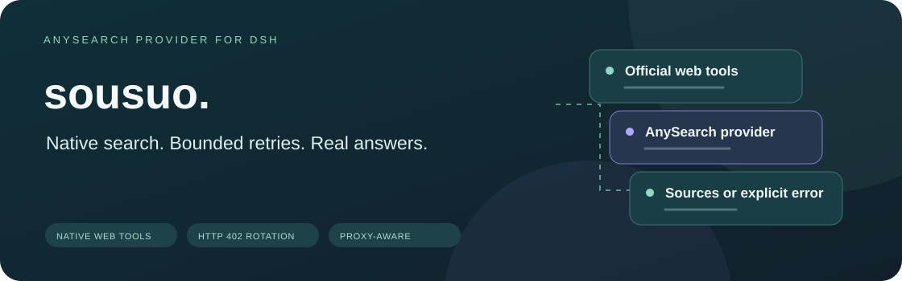
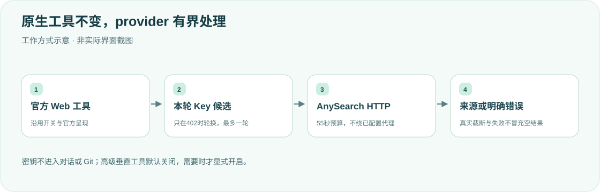

<div align="center">

<h1>sousuo · 搜索之后，给出答案</h1>
<p><strong>原生 web_search / web_fetch，AnySearch 后端与有界 402 轮换。</strong></p>
<p><strong>简体中文</strong> · <a href="README.en.md">English</a></p>
<p><a href="package.json">v0.1.13</a> · <a href="LICENSE">MIT</a> · DSH desktop provider</p>
<p><a href="#核心能力">核心能力</a> · <a href="#工作方式">工作方式</a> · <a href="#安装">安装</a> · <a href="#key-文件">Key文件</a> · <a href="#说明">边界</a> · <a href="#开发">开发</a></p>
</div>

---

个人桌面工作流的参考实现，使用前核对自己的官方 Host 版本与配置，不建议直接照搬。**Key 只放本机私有文件，不进入 patch、Git 或对话。**

## 核心能力

<table><tr>
<td width="33%"><strong>🔎 官方原生工具</strong><br/><br/>提供AnySearch provider，沿用官方web工具开关、渲染和错误语义。</td>
<td width="33%"><strong>🔄 仅402轮换</strong><br/><br/>本次候选快照最多一轮；401/403/429不换Key，不把异常当空结果。</td>
<td width="33%"><strong>🌐 受约束联网</strong><br/><br/>系统重试与受检IPv4 fallback共享55秒预算，不绕代理发送凭据。</td>
</tr><tr>
<td><strong>🛡 私有状态</strong><br/><br/>Key校验不回显，0600暂存原子保存；坏状态保留并明确报错。</td>
<td><strong>📏 有界结果</strong><br/><br/>响应字节、来源URL与模型正文都有上限，实际截断可见。</td>
<td><strong>🧭 简洁默认工具面</strong><br/><br/>默认只用原生搜索；确需垂直tag才显式开启anysearch_*工具。</td>
</tr></table>

## 工作方式




DeepSeek Harness 官方桌面端的搜索 Provider。`web_search` / `web_fetch` 仍走 AnySearch HTTP API；本地用多把 API Key，遇到 HTTP 402 时立刻换下一把并重试同一请求。一次请求最多转一圈，然后失败。401 / 403 / 429 不换号。连不上 API 的 `TypeError: fetch failed` 会先按系统 DNS 再试一次，仍失败且目标无需环境代理时，才用公共 DNS/DoH 解析到的 IPv4 直连（SNI 仍是请求主机名），避免本机缓存到失效 GTM 节点时整次搜索直接失败。配置 `HTTP_PROXY` / `HTTPS_PROXY` / `ALL_PROXY` 时保留系统代理路径，绝不绕代理发送凭据；`NO_PROXY` 仅对能安全确认的常用规则启用直连，其他规则只会停用 fallback。

默认**不**向模型暴露 `anysearch_capabilities` / `anysearch_search` / `anysearch_batch_search`。Grok 等高推理模型看见这组工具后，容易先做能力发现、搜完只在思考里说「再搜一次」然后 `stop`，界面就像调用网络时自动停了。普通问题走 `web_search` 即可，后端已经是 sousuo。若确实需要垂直 tag，在 desktop patch 里给本插件加 `advancedTools: true`。

在「插件 → 搜索」中可以添加和删除 Key、查看数量、主动测试连接，以及设置默认结果数量、区域和语言。测试连接会发送真实搜索请求，可能产生费用；Key 内容不回传页面，文件以私有权限保存。高级工具显式参数优先，原生搜索的最终展示数量仍受官方限制。高级配置区只读显示启动时的 Host 配置，修改 Host 配置需完全退出并重启。为保护凭据，Host 的 `baseURL` 必须使用 HTTPS。

面向 **官方桌面**。不要把 Key 写进 patch、README、Git 或对话。

## 安装

1. 复制本仓库到 `$DSH_HOME/plugins/sousuo`（默认 `$DSH_HOME` 为 `~/.dsh`）。
2. 在 `$DSH_HOME/profiles/desktop/package.json` 的 `dependencies` 增加 `"sousuo": "file:../../plugins/sousuo"`，同时把 `sousuo` 加入 `dsh.profile.bundles`。包的 `dsh.bundle.patch` 负责插入插件入口，profile 不再手工添加第二个 `insert`。
3. 使用当前 DSH 随附的 pnpm 在该 profile 运行 `install --ignore-scripts`，保留生成的 `pnpm-lock.yaml`。profile 的 `pnpm-workspace.yaml` 保持 `nodeLinker: hoisted`、`autoInstallPeers: false`。pnpm 可能把 `file:` 依赖物化为 profile 内的目录快照或指向源码的链接；两者都以 package 声明和 bundle 入口为准，不要手工复制未声明目录。
4. 在 `$DSH_HOME/profiles/desktop/cordis.patch.yml` 只修改 bundle 条目的配置：

```yaml
- id: sousuo
  config:
    baseURL: https://api.anysearch.com
    # keysPath / statePath / advancedTools 均可选

- id: web
  config:
    searchProvider: sousuo
    fetchProvider: sousuo
```

`- id: sousuo` 修改 profile bundle 已注册的实例；不要再添加同 ID 的 `insert`，否则可能重复注册。包声明 `@deepseek-ai/dsh-web` / `@deepseek-ai/dsh-tools` / `@deepseek-ai/schemastery` 为 Host 提供的 peer，不另装官方 runtime。打包白名单不包含 `keys`、`state.json`、`.credentials.yaml` 或本地 `node_modules`。`- id: web` 会整段替换 `web` 的 config。修改后完全退出 DeepSeek Harness（macOS：⌘Q）再打开。

## Key 文件

只存在本机，不进 Git。路径：`$DSH_HOME/plugins/sousuo/keys`

```
# 一行一把，# 开头为注释
```

```bash
cp keys.example keys
chmod 600 keys
```

用编辑器把真实 Key 写进 `keys`，不要贴到聊天里。Key 文件最多 16 KiB、单行最多 4 KiB；POSIX 系统要求 `keys` 不具有 group/other 权限，推荐 `chmod 600 keys`。C0/C1 控制字符在 trim 前就被拒绝，错误仅报告行号、不回显 Key。当前序号默认记在 Key 文件同目录的 `state.json`；自定义 `keysPath` 时也会派生同目录状态，仍可通过 `statePath` 显式覆盖。每次请求捕获独立的 current-first 候选槽位快照，最多遍历一轮，不会因并发切换而跳过或重复 Key。

状态通过同目录独占创建的 0600 临时文件、完整写入/fsync/close、原子 rename 更新；写入失败保留旧状态并报告错误。这不是跨进程锁，也不承诺断电持久性。

`state.json` 不存在时自动初始化。文件无法读取、JSON 损坏或序号格式错误时会明确报错并保留原文件，不会静默重置；请先检查、修复状态文件，再重试。

## 说明

- 仓库不含本机 patch、账号、Key 或 `state.json`
- 后端是 AnySearch；本插件只做 Provider 适配、402 轮换，以及搜完必须作答的系统提示
- `web_search` / `web_fetch` 由官方 `tool-web` 注册并控制开关；插件只提供 AnySearch provider，不会把关闭的 `web_fetch` 重新开启
- 原生搜索的安全声明由官方 `tool-web` 渲染一次，provider 不把声明伪装成 `content` / answer。正常零结果显示 `No results found.`；来源被裁剪后为空时明确显示 `No usable source URLs retained (source list truncated).` 与截断提示；请求失败和取消仍抛出官方 `WEB_PROVIDER_ERROR` / `WEB_ABORTED`，不返回空成功
- DNS 直连支持响应断流、取消和空响应；公共 UDP DNS 查询最多使用 2.5 秒，停止操作会取消查询
- 成功响应的正文断流进入同一 Key 重试和 IPv4 fallback；真正的 JSON 格式错误不重试。错误响应即使正文断流，也保留 HTTP 状态：402 换下一把 Key，401 / 403 / 429 不重试、不轮换，保留 `Retry-After`。连接、正文读取和 DNS fallback 共用当前 HTTP 请求的 55 秒时限，取消和超时优先停止后续尝试
- 502 / 503 / 504 重试前释放旧响应；取消或失败退出时也会释放仍持有的旧响应。最终返回的错误响应仍可读取正文
- 所有 API 响应在 JSON 解析前限制为 5,000,000 字节；系统 fetch 按解码后字节计数。IPv4 pinned 请求要求 `identity` 编码，服务器若仍返回 gzip/br 等编码则明确失败、不重试，错误 HTTP 状态仍保留
- 搜索最多保留 50 个来源，标题 1,000、摘要 2,000、URL 4,000 字符；仅接受无凭据的绝对 HTTP(S) URL，超长 URL 整条省略。原生 Markdown 展示会把 URL 中的方括号和圆括号编码为百分号形式，阻止来源 URL 截断链接或伪造额外链接。诊断字段最多 256 字符，错误消息最多 2,000 字符，并对本次候选 Key 与错误 cause 做脱敏
- 高级搜索、批量搜索和能力目录的 `maxRenderedContentChars`（默认 12,000）限制的是**全部模型正文**，包含通知、来源、内容、截断提示和 followthrough footer；批量五项共享同一预算。极小预算只显示截断标记，不产生残缺引用链接。原生 provider 的单查询投影同样保留官方渲染开销，总体不超过 12,000 字符；官方多查询合并只限制总来源条数，不提供整次调用的字符上限
- 高级搜索和批量搜索会同时报告客户端 20 万字符正文上限、来源裁剪与整体渲染预算造成的截断；未请求正文时不会报告正文截断。能力目录裁剪也有明确 `truncated` 标记，保留的 tag/参数名不会截成其他标识
- 本地提取的 55 秒 HTTP 截止映射为官方 `WEB_FETCH_TIMEOUT`，响应超大映射为 `WEB_FETCH_TOO_LARGE`；取消仍为 `WEB_ABORTED`，不会伪装成正常空结果
- `advancedTools` 默认关闭；打开后才会注册 `anysearch_*` 工具
- 测试里的 `k1` / `k2` 是假值，不是真实凭据

## 开发

当前版本：`0.1.13`。源码唯一来源为 `$DSH_HOME/plugins/sousuo`；profile 通过 `file:` 依赖、`dsh.profile.bundles` 和锁文件管理安装。修改后同步递增 `package.json`、`lib/version.js` 与文档版本，执行 profile 的 `install --ignore-scripts`，核对 `node_modules/sousuo/lib/index.js`、全部 `lib/` 文件和公开包文件与源码一致。若 pnpm 保留旧目录快照，移除并重新添加该 `file:` 依赖后再安装；若 lock 使用 `link:`，重启 Host 才能重新加载模块。不要把 API Key 写入依赖、bundle 配置或锁文件。

运行期由宿主提供 `@deepseek-ai/dsh-web`、`@deepseek-ai/dsh-tools` 与 `@deepseek-ai/schemastery`，`lib/` 直接 import 它们，因此都声明在 `peerDependencies` 里；插件不随包携带这些官方模块的副本，避免与宿主模块实例不一致（`instanceof` 与 service 身份都会受影响）。

例如（`PNPM_CLI` 指向当前安装 DSH 的 `Contents/Resources/runtime/primary-runtime/dependencies/pnpm/bin/pnpm.mjs`）：

```bash
DSH_HOME=${DSH_HOME:-$HOME/.dsh}
/usr/local/bin/node "${PNPM_CLI:?Set PNPM_CLI to the current bundled pnpm}" --dir "$DSH_HOME/profiles/desktop" install --offline --ignore-scripts

# 仅当目录快照没有同步源码时执行：
/usr/local/bin/node "$PNPM_CLI" --dir "$DSH_HOME/profiles/desktop" remove sousuo --config.ignore-scripts=true
/usr/local/bin/node "$PNPM_CLI" --dir "$DSH_HOME/profiles/desktop" add file:../../plugins/sousuo --offline --ignore-scripts
```

先将当前官方桌面 bundle 解包到只读参考目录（根目录包含 `node_modules`），并设置 `DSH_OFFICIAL_REFERENCE`。原生契约测试直接导入该目录中的官方 `cordis`、`dsh-web` 和 `dsh-tool-web`；缺少参考目录时明确失败，不跳过、不使用模拟 renderer。

```bash
export DSH_OFFICIAL_REFERENCE=/path/to/extracted-current-dsh
export DSH_PROFILE_TEST_PNPM=/path/to/current-app/Contents/Resources/runtime/primary-runtime/dependencies/pnpm/bin/pnpm.mjs
for file in lib/*.js lib/tools/*.js; do /usr/local/bin/node --check "$file" || exit; done
/usr/local/bin/node --test test/*.test.mjs
```

测试使用假 Key 和本机 HTTP/UDP/代理服务，覆盖并发候选轮换、控制字符与错误脱敏、写入/同步/rename 失败保留状态、代理与 NO_PROXY、旧响应/socket 释放、成功及错误状态正文断流、取消/时限、原始响应字节上限、危险 URL、原生 Markdown 链接边界、`__proto__` 参数、搜索/批量/目录整体输出预算与真实截断标记，不请求真实 AnySearch API。原生搜索测试通过真实官方 WebRuntime 注册 provider，再调用官方工具的 `execute`、`output.render`、`presentationMeta` 和 `presentResult`，覆盖正常零结果、截断空结果、单/多查询声明去重、来源限额、原生渲染预算、错误和取消。另有使用当前 bundled pnpm 的隔离回归，验证文件依赖安装、普通/frozen-lockfile 重装、源码同步及打包凭据排除。它们不代表运行中的 Host 已加载最新插件；修改后仍须同步 desktop profile 的 bundle 安装，并完全退出 DeepSeek Harness（⌘Q）再打开，实测原生工具。

<details>
<summary><strong>为什么不在401、403或429时换Key？</strong></summary>

轮换仅处理明确的402额度语义，不把认证、权限或限流错误伪装成另一个账号的成功。一次请求只遍历自己的候选快照一轮；全部失败仍报错。

</details>

[MIT License](LICENSE)。

<div align="center"><sub>认真搜索，如实呈现结果。 · <a href="README.en.md">Read in English →</a></sub></div>
